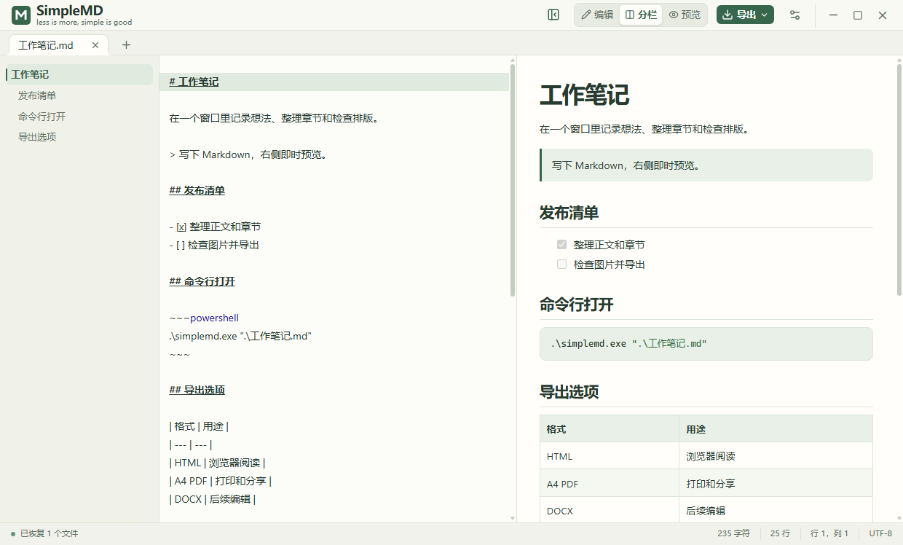

# SimpleMD
轻量的 Windows Markdown 阅读与编辑器

> less is more, simple is good.



## 开发与构建

项目使用 Tauri、Vue 3、TypeScript、Rust 和 SQLite。准备 Node.js、Rust MSVC 工具链、Visual Studio C++ 构建工具、Windows SDK 和 Microsoft Edge WebView2。

在 Visual Studio 的 **x64 开发者终端**中进入项目目录，确认 `cargo` 已加入 `PATH`，再运行以下命令。

```powershell
npm ci
npm run tauri -- dev
```

| 构建目标 | 命令 | 输出 |
| --- | --- | --- |
| **Windows x64 EXE** | `npm run tauri -- build --no-bundle` | `src-tauri/target/release/simplemd.exe` |
| **NSIS 安装包** | `npm run tauri -- build --bundles nsis` | `src-tauri/target/release/bundle/nsis/` |

## 许可证

[GNU GPL v2](LICENSE.txt)
